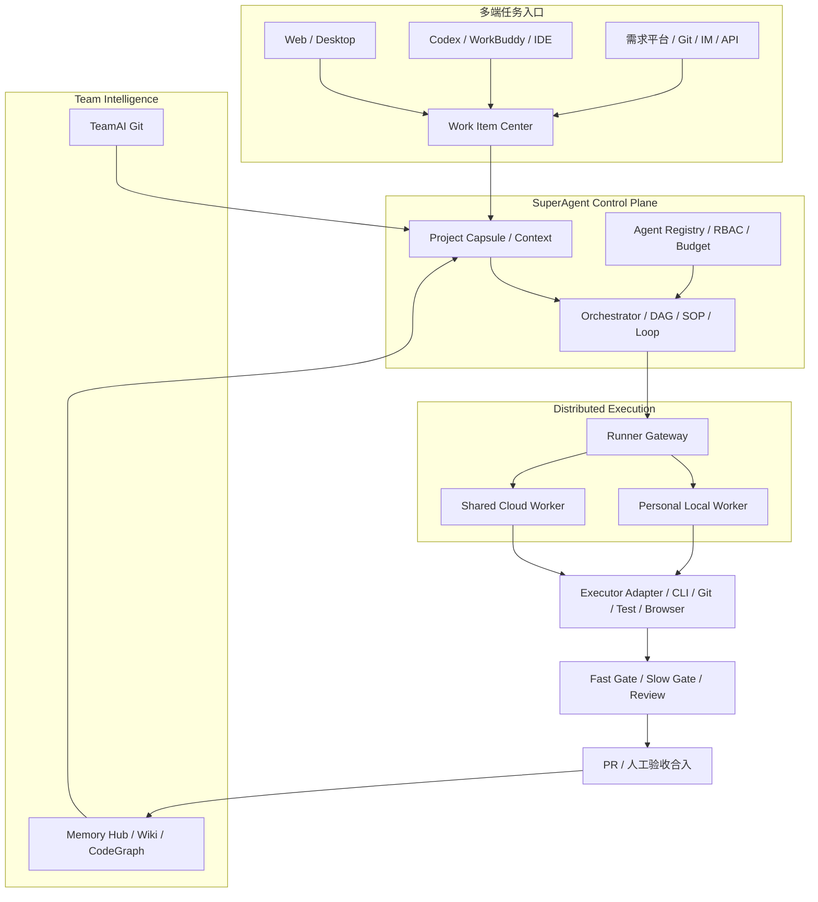
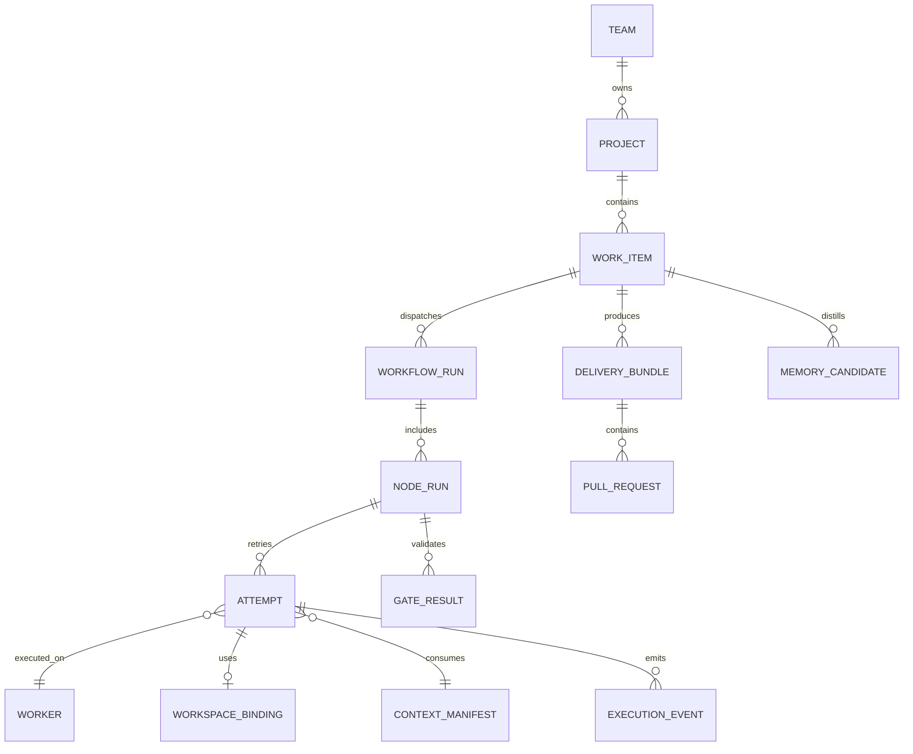
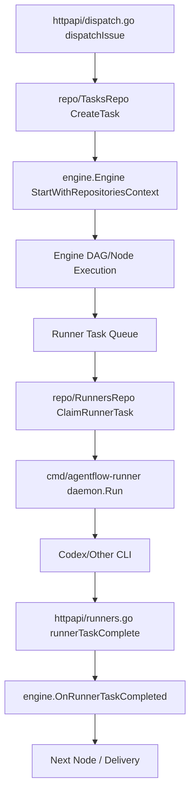

# SuperAgent 企业级 AI 研发协作平台——全轮技术讨论归档

> 日期：2026-11-15  
> 范围：本次对话从最初技术方案讨论至 P0 源码验证和工程实施方案，共四轮架构推演，含用户确认的四项架构决策。  
> **归档说明**：这是依据当前会话可用内容整理的**结构化全量议题归档**，不是聊天平台导出的逐字逐句原始记录。用户要求及关键决策按原文记录；助手长篇答复合并同类项、保留架构设计、技术协议、代码样例、路径、验收标准。若需要法律或审计意义上的逐字聊天记录，请从 ChatGPT 导出原始对话。

---

## 对话索引

1. 第一轮：SuperAgent 定位、开源项目选型、Control Plane / Runtime / Memory 总体架构
2. 第二轮：云端与本地 Worker 通信、SAWP、任务状态与租约、断线恢复、Agent Handoff
3. 第三轮：LoopForge 优先复用、混合 Worker、独立 Worktree、PR 人工合入、数据模型及实施路线
4. 第四轮：P0 LoopForge 源码审计、Runner 实际能力、Sandbox 隔离、Lease/Fencing 风险、首批工程任务
5. 术语、技术选型、GitHub 链接、关键协议及 P0 工作项

---

# 第一轮：SuperAgent 总体架构

## 用户原始诉求

> 讨论技术方案：
> 我要实现一个结合本地AI工具（codex、workbuddy等）和各类CLI，来实现superAgent管理研发工具；
> 要求实现团队化、团队记忆云端化实现共享共同成长，N个agent分工协作，自动loop来实现从需求到研发完成；参考的技能项目：
> https://github.com/nightly-labs/openbot
> agent可视化：https://github.com/raylee-ai/lancer
> https://github.com/TencentCloud/Octop.git
> 记忆：https://github.com/TencentCloud/TencentDB-Agent-Memory.git
> https://github.com/Tencent/teamai-cli
> https://github.com/Tencent/LoopForge.git
> 你也可以查找更多合适的开源项目，我们先讨论完整这个方案的架构

## 1. 核心定位

SuperAgent 不应重复实现一个单体 AI Coding 工具，而应是企业级研发 Agent Control Plane：

- **Cloud Control Plane**：需求、工作项、DAG、SOP、角色编排、权限、审批、调度。
- **Distributed Execution Plane**：个人本地 Worker 与云端共享 Worker，调用 Codex / WorkBuddy / Claude Code / OpenCode / 普通 CLI。
- **Team Intelligence Plane**：TeamAI 的团队 Rules/Skills/Agents/MCP 配置，Memory Hub 的经验、Wiki、CodeGraph，Context Manifest 的可追溯上下文。
- **Delivery Harness**：Git 隔离、Fast/Slow Gate、独立 Review、自动修复 Loop、PR 和人工合入。

核心原则：云端管控制、本地管执行；以任务而非 Agent 会话为第一等实体；Agent 角色与具体执行器解耦；自动 Loop 以测试/验证证据驱动；团队记忆以经过治理的知识资产形式共享。

## 2. 项目选型讨论

| 项目 | 候选职责 | 主要判断 |
|---|---|---|
| [Tencent/LoopForge](https://github.com/Tencent/LoopForge) | SOP、DAG、Agent Runner、Sandbox、交付 | 首选工程编排基座，需审查扩展点及隔离机制 |
| [TencentCloud/TencentDB-Agent-Memory](https://github.com/TencentCloud/TencentDB-Agent-Memory) | Chat Memory、知识与 CodeGraph | 团队共享记忆候选引擎 |
| [Tencent/teamai-cli](https://github.com/Tencent/teamai-cli) | 团队 Agent/Rules/Skills/Hooks/MCP 配置同步 | 版本化规范与正式团队配置 |
| [nightly-labs/openbot](https://github.com/nightly-labs/openbot) | 本地常驻 Agent、任务队列、通信 | 借鉴本地 Agent 工作区；企业部署需重新评估危险权限 |
| [raylee-ai/lancer](https://github.com/raylee-ai/lancer) | 多会话、GitTree、执行可视化 | 借鉴桌面体验与 Agent 运行图 |
| [TencentCloud/Octop](https://github.com/TencentCloud/Octop) | 多用户、多 Agent、IM、ACP | 借鉴多用户与消息入口 |
| [openai/symphony](https://github.com/openai/symphony) | 工作项持续监控与调度 | 借鉴独立执行与状态恢复 |
| [OpenHands/OpenHands](https://github.com/OpenHands/OpenHands) | Agent Server 与 Workspace | 借鉴执行服务分层 |
| [temporalio/temporal](https://github.com/temporalio/temporal) | 持久化长流程 | 自研编排路线的备选，不与 LoopForge 并列作顶层权威 |
| [langchain-ai/langgraph](https://github.com/langchain-ai/langgraph) | 动态 Agent 子流程 | 按需作为子流程，不构成第二套顶层 Scheduler |
| [agentclientprotocol](https://github.com/agentclientprotocol) | ACP 标准 | 适配 Agent 与客户端交互 |
| [coder/coder](https://github.com/coder/coder) | 云端开发环境 | 共享 Worker 工作区候选 |
| [langfuse/langfuse](https://github.com/langfuse/langfuse) | Trace / Cost / Evaluation | 观测与评估 |

尤其区分：TeamAI 正式 Rules/Skills 与 Memory Hub 运行知识不是同一种主数据；ACP 和 MCP 也不能混为一谈。

## 3. 推荐的总体部署架构



### 六个领域模块

1. Work Item Center：需求、Bug、合并拆分、验收契约。
2. SuperAgent Orchestrator：Task DAG、SOP、调度、重试、恢复。
3. Agent Runtime：Worker Daemon、异构 CLI Adapter、Session。
4. Team Intelligence：正式团队配置、知识索引与共享记忆。
5. Delivery Harness：Worktree、Git、测试、Review、PR。
6. Operations Console：DAG、事件流、成本、质量、资源与审批。

## 4. 多 Agent 团队结构

角色（Role）与实例（Instance）与执行器（Executor）必须区分。常见角色包括：SuperAgent Lead、Requirement Agent、Architecture Agent、Frontend Agent、Backend Agent、Test Agent、Review Agent、Fix Agent、Integration Agent、Memory Curator。

一项工作可拆为：需求澄清 → 架构与 API 契约 → 前后端/测试并行 → 分支集成 → 测试 → Review → Fix Loop → PR → 人工验收 → 记忆沉淀。

每个有写权限的 Agent 使用自己的工作区，跨设备通过 Git Commit / Patch / Artifact 交接。独立 Review 应尽量与编码 Agent 隔离。

## 5. 团队记忆分层

| 层 | 内容 |
|---|---|
| L0 Raw Evidence | 原始需求、代码、日志、测试记录、附件 |
| L1 Task/Agent Memory | 当前任务决策、临时上下文、检查点 |
| L2 Team Experience | 失败模式、修复经验、模块注意事项 |
| L3 Verified Knowledge | 业务规则、接口契约、架构决策、最佳实践 |
| L4 Team Policy / Capabilities | 正式 Agent、Rules、Skills、MCP、SOP |

该分层是 SuperAgent 设计，不等同于 TencentDB Agent Memory 自身会话记忆分级。每条重要记忆有来源、项目/团队权限、代码版本、验证状态、审批人及有效期；不应无条件自动把一次 AI 输出升级为团队正式规则。

## 6. 自动 Loop 三层

- **内环 Agent Loop**：Plan → Act → Observe，由各 AI CLI 自行实现。
- **工程修复外环**：编码 → Fast Gate → Slow Gate → 失败归因 → Fix → 重新验证；按失败签名、尝试次数和预算有界控制。
- **交付反馈环**：PR → CI → Review → 验收 → 打回修复或完成；人工合入。

任务不能由 Agent 仅口头宣称完成，必须以固定 Commit SHA 与测试/审批证据确定。

## 7. 第一轮建议与下一轮方向

优先技术验证 LoopForge，确认执行与隔离现状；SuperAgent 不必比 Codex 更会写代码，而应更擅长组织研发、管理 Agent、证据化验证及知识沉淀。下一轮需深入 Cloud Control Plane ↔ Local Runtime 协议、状态机和异常恢复。

---

# 第二轮：Control Plane 与 Local Runtime 协议

## 用户原话

> 进行下一轮的讨论

## 1. 目标场景

模拟 CRM 回款待办中心改造：前端待办列表与状态展示，后端回款达标判断、接口和规则，测试覆盖自动达标、部分回款、目标调整等。需求分析 → 架构确认 API 契约 → 前端、后端、测试并行 → 集成 → 回归 → 独立 Review → PR → 记忆沉淀。

## 2. SAWP（SuperAgent Worker Protocol）逻辑设计

这是 SuperAgent 自定义的跨设备控制协议，不等于 ACP / MCP / CLI 私有协议。主消息：

| 消息 | 方向 | 语义 |
|---|---|---|
| WorkerRegister | Worker → Cloud | 操作系统、工具版本、CLI 功能和资源容量 |
| WorkerHeartbeat | Worker → Cloud | 健康状态、运行任务和负载 |
| TaskAcquire / LeaseRenew | 双向 | 获取任务、续租、防止重复授权 |
| TaskCommand | Cloud → Worker | 启动、取消、恢复或暂停 |
| ExecutionEvent | Worker → Cloud | 结构化 Agent 输出、工具调用及验证信息 |
| TaskResult / Reconcile | 双向 | 结果接收、断线后状态对账 |

建议本地 Worker 主动出站连接，不把主机端口暴露给云端直接控制。调度以 Capability 而非品牌为条件，至少验证：non_interactive、stream_events、resume、cancel、沙箱、工具版本、项目授权。

### ExecutorAdapter 草案

```typescript
interface ExecutorAdapter {
  probe(): Promise<ExecutorCapabilities>;
  execute(request: ExecutionRequest): AsyncIterable<ExecutionEvent>;
  cancel(runId: string): Promise<void>;
  resume?(checkpoint: ExecutionCheckpoint): AsyncIterable<ExecutionEvent>;
}

interface ExecutionRequest {
  runId: string;
  taskId: string;
  roleId: string;
  workspacePath: string;
  contextManifest: string;
  input: string;
  timeoutSeconds: number;
  approvalPolicy: string;
}
```

对 Codex 优先调研 SDK / App Server；对支持 ACP 的工具使用 ACP Adapter；对普通 Git、Shell、Test 使用 Process Adapter。WorkBuddy 完整无头执行与 Session 恢复能力需单独核实，不能把已安装等同于可远程自动调度。

## 3. 三套不同状态

| 状态对象 | 权威方 | 作用 |
|---|---|---|
| Task / WorkItem | Cloud Control Plane | 业务任务、验收状态和依赖 |
| Attempt | 云端发起，本地执行，云端确认 | 单次执行、租约、失败、重试 |
| Agent Session | Local Worker / Executor | CLI 原生会话、恢复引用 |

Task 示例：PENDING → READY → DISPATCHED → RUNNING → VERIFYING → REVIEW_READY → COMPLETED；失败可转 BLOCKED 或返回 READY。

Attempt 示例：CREATED → LEASED → PREPARING → EXECUTING → RESULT_REPORTED → FINALIZED；还应有 UNKNOWN、FAILED、TIMED_OUT、CANCELED。

核心身份：`task_id`、`attempt_id`、`worker_id`、`lease_id`、`generation`、`context_manifest_id`、`base_commit`、`native_session_id`。

## 4. Task Assignment 示例

```json
{
  "protocol": "sawp/1.0",
  "type": "task.assign",
  "work_item_id": "REQ-2026-009",
  "task_id": "TASK-FE-003",
  "attempt_id": "ATTEMPT-001",
  "agent": {"role": "frontend-engineer", "executor": "codex"},
  "lease": {"lease_id": "LEASE-001", "generation": 12},
  "context": {"capsule_id": "CAPSULE-009", "manifest_id": "CTX-009-v3"},
  "workspace": {
    "repository": "crm-frontend",
    "base_commit": "full-git-commit-sha",
    "branch": "agent/REQ-2026-009/frontend"
  },
  "constraints": {
    "max_runtime_seconds": 3600,
    "max_fix_attempts": 3,
    "sandbox_profile": "restricted-dev",
    "allow_push": false
  },
  "expected_artifacts": ["code_patch", "test_report", "implementation_summary"]
}
```

## 5. 租约、断线与执行副作用

Worker 断线后先标记 SUSPECT、暂停新任务；恢复时核对 Session、进程、Workspace、租约；超时后失效旧世代。**租约过期不代表旧进程物理停止**，故禁止旧 Attempt 凭过期权限继续写 Git。最终 Git Push、PR 创建等高权限操作应由受控 Delivery Gateway 处理，并采用幂等键及分支保护。

事件按 `eventId` 去重、Attempt 内 `sequence` 排序，离线缓冲后按确认水位补传；大型日志存 Artifact Store，敏感日志脱敏。

### ExecutionEvent 草案

```typescript
interface ExecutionEvent {
  eventId: string;
  runId: string;
  attemptId: string;
  workerId: string;
  sequence: number;
  timestamp: string;
  type:
    | "session.started" | "agent.message"
    | "tool.started" | "tool.completed"
    | "file.changed" | "artifact.created"
    | "test.completed" | "approval.requested"
    | "run.completed" | "run.failed";
  payload: Record<string, unknown>;
  artifactRef?: string;
  traceId?: string;
}
```

## 6. Handoff 与 Context Builder

多 Agent 交接必须使用结构化 Artifact，而不是仅靠聊天摘要：来源需求、接口契约、业务决策、未解决问题、上下文版本、验收条件。Context Builder 在任务开始时汇总 TeamAI Rules/Skills、Memory、CodeGraph、前序成果；生成不可变 Manifest；执行后经过验证才进入 Memory Candidate / TeamAI PR。

## 7. 三道门禁

Gate 1 Fast：Lint、Type Check、编译、单元测试、结构与基本策略。  
Gate 2 Slow：集成/E2E、业务规则、独立 Review、安全。  
Gate 3 Delivery：固定 Commit SHA、CI、PR、人工验收。

每次修复需记录 Failure Signature，且采用超时、预算、无进展停止和敏感问题人工复核。最后由用户确认进入第三轮的四项决策。

## 用户已选择的架构决策（原文）

> 继续 SuperAgent 第三轮架构讨论，请按以下已选择的决策设计详细技术方案、模块接口、数据模型与首期实施路线：编排引擎：LoopForge 优先复用并扩展（推荐）；执行部署模式：本地个人 Worker + 云端共享 Worker（推荐）；代码协作方式：独立 Worktree + Git 分支集成（推荐）；自动交付边界：自动到 PR，人工验收合入（推荐）

---

# 第三轮：工程架构、API、ER 模型和实施路线

## 1. 已确认的架构基线

- **编排**：LoopForge Engine 是唯一顶层工作流运行权威。
- **执行**：本地个人 Worker + 云端共享 Worker；可按 Capability/Trust/Policy 分配。
- **代码**：独立工作区，同机用 Worktree，跨机器采用独立 Clone 与 Git 分支；统一集成。
- **交付**：AI 可到 PR，合入必须人工批准。PR_READY ≠ 研发需求已完成。

偏好“模块化单体 Control Plane + 独立部署的 Worker / 知识系统”，先做受控 Fork 和必要扩展，不立即微服务化。

## 2. 领域划分

| 模块 | 职责 |
|---|---|
| Work Item Center | 外部需求映射、澄清、审批和计划 |
| LoopForge Engine | SOP、DAG、节点调度、Lease、Retry |
| Capability Registry | Worker CLI 能力、权限、资源、信任等级 |
| Context Builder | Project Capsule、不可变 Context Manifest |
| Runner/Execution Gateway | Claim、Renew、Events、Complete、Reconcile |
| Delivery Manager | Git 集成、Gate、PR、交付证据 |
| Team Intelligence | TeamAI + Memory Hub / CodeGraph |
| Console | DAG、运行进度、成本、人工审批、异常接管 |

## 3. 模块 API 契约

```typescript
interface WorkItemService {
  importRequirement(input: ExternalRequirement): Promise<WorkItem>;
  createPlan(id: string): Promise<WorkPlan>;
  approvePlan(id: string, revision: string): Promise<void>;
  dispatch(id: string): Promise<WorkflowBinding>;
}
interface ContextService {
  resolve(input: ContextRequest): Promise<ContextManifest>;
  verify(manifestId: string): Promise<VerificationResult>;
}
interface AgentRegistry {
  listEligibleWorkers(task: TaskSpec): Promise<WorkerRef[]>;
  resolveExecutor(role: AgentRole, worker: WorkerRef): Promise<ExecutorRef>;
}
interface OrchestrationService {
  start(workItemId: string, planId: string): Promise<RunRef>;
  retry(runId: string, nodeId: string): Promise<RunRef>;
  cancel(runId: string): Promise<void>;
}
interface DeliveryService {
  integrate(runId: string): Promise<IntegrationResult>;
  evaluate(runId: string): Promise<GateReport>;
  submitPR(runId: string): Promise<DeliveryBundle>;
}
```

建议对外版本前缀 `/api/superagent/v1`，包括 `/work-items/import`、`/work-items/{id}/plans`、`/plans/{id}/approve`、`/work-items/{id}/dispatch`、`/work-items/{id}/graph`、`/workers`、`/context-manifests/resolve`、`/runs/{id}/events`、`/runs/{id}/gates`、`/deliveries/{id}/submit-pr`、`/memory-candidates/{id}/approve`。

这些是**设计提案，不等于 LoopForge 已实现 API**。

## 4. 核心 ER 关系



工作项/Task/Attempt 分开；LoopForge 现有 WorkflowRun、NodeRun、Engine Lease 不应再复制一套权威表。可添加扩展实体：`sa_work_item_binding`、`sa_project_policy`、`sa_worker_capability`、`sa_context_manifest`、`sa_node_workspace`、`sa_execution_session`、`sa_gate_result`、`sa_delivery_bundle`、`sa_delivery_pr`、`sa_memory_candidate`、`sa_integration_event`。

### MySQL 扩展表草案

```sql
CREATE TABLE sa_work_item_binding (
  id VARCHAR(40) PRIMARY KEY,
  project_id VARCHAR(64) NOT NULL,
  external_system VARCHAR(32) NOT NULL,
  external_id VARCHAR(128) NOT NULL,
  loopforge_issue_id VARCHAR(64) NOT NULL,
  active_run_id VARCHAR(64),
  plan_revision VARCHAR(64),
  created_at DATETIME(3) NOT NULL,
  updated_at DATETIME(3) NOT NULL,
  UNIQUE KEY uk_external (external_system, external_id),
  KEY idx_issue (loopforge_issue_id),
  KEY idx_run (active_run_id)
);

CREATE TABLE sa_context_manifest (
  id VARCHAR(40) PRIMARY KEY,
  project_id VARCHAR(64) NOT NULL,
  manifest_hash CHAR(64) NOT NULL,
  manifest_json JSON NOT NULL,
  artifact_uri VARCHAR(1024),
  created_at DATETIME(3) NOT NULL,
  KEY idx_project (project_id),
  KEY idx_hash (manifest_hash)
);

CREATE TABLE sa_node_workspace (
  id VARCHAR(40) PRIMARY KEY,
  run_id VARCHAR(64) NOT NULL,
  node_id VARCHAR(64) NOT NULL,
  attempt_id VARCHAR(64) NOT NULL,
  worker_id VARCHAR(64) NOT NULL,
  repository_id VARCHAR(64) NOT NULL,
  base_commit CHAR(40) NOT NULL,
  work_branch VARCHAR(255) NOT NULL,
  result_commit CHAR(40),
  workspace_ref VARCHAR(512),
  context_manifest_id VARCHAR(40) NOT NULL,
  created_at DATETIME(3) NOT NULL,
  UNIQUE KEY uk_attempt_repo (attempt_id, repository_id),
  KEY idx_run_node (run_id, node_id),
  KEY idx_manifest (context_manifest_id)
);
```

注意：这是草案，真实 Migration 应与 LoopForge 既有主键、Repo、迁移顺序和 GORM 约定相容。跨 Git、MySQL 和记忆系统的操作使用 Transactional Outbox + 幂等消费，不应假设分布式事务。

## 5. 两级调度

第一层由 LoopForge 判断 Node 是否 Ready；第二层根据权限、CLI 能力、沙箱、Worker 容量、环境、位置、预算进行候选过滤和确定性评分。租约必须由 Engine 原子认领，不能在另一个 Scheduler 里维护竞争性权威。

```python
def schedule_ready_nodes(run):
    for node in engine.get_ready_nodes(run.id):
        task = build_task_spec(node)
        candidates = worker_registry.find_eligible(
            required_capabilities=task.capabilities,
            project_id=task.project_id,
            isolation=task.isolation,
            permissions=task.permissions,
        )
        if not candidates:
            engine.mark_waiting_capacity(node.id)
            continue
        worker = rank_workers(candidates, task=task, policy=task.scheduling_policy)[0]
        lease = engine.try_claim_node(run_id=run.id, node_id=node.id, worker_id=worker.id)
        if lease is not None:
            runner.dispatch(build_assignment(task=task, worker=worker, lease=lease))
```

以上为目标伪代码，**不是现有 LoopForge 的真实函数签名**。

## 6. Git Workspace 协作

同一代码仓：每个写代码 Node 独立 Worktree/分支 → Integration Agent 专用集成分支 → 固定 Commit SHA Gate → Review → PR。跨代码仓：每仓独立 PR、使用 Delivery Bundle 联合追踪，不能假设跨仓原子合入。

推荐 ChangeScope 声明可修改路径和受保护路径、依赖关系；它可减少误修改，但不能替代沙箱权限。共享 Schema/API/数据库迁移应先由 Architecture Agent 确认契约。

```yaml
workspace_policy:
  isolation: node
  mode: git_worktree
  write_scope: declared_paths
```

## 7. 正式团队配置与记忆

TeamAI 是 Rules、Skills、Agents、MCP 正式版本的 Git 主数据；Memory Hub 保存知识、经验、索引与候选改进；Context Builder 只负责按权限与版本构建 Manifest。避免三套系统同时编辑同一份知识原文。

关键记忆指标：Relevant Recall Rate、Evidence Coverage、Stale Knowledge Rate、Knowledge Reuse Rate、Correction Rate。

## 8. 实施阶段

| 阶段 | 工作重点 | 退出标准 |
|---|---|---|
| P0 | LoopForge 调用链、Mac/Linux Codex、基线 | 真实 Run 到 PR 可复现 |
| P1 | Node Workspace、Worker 能力、跨设备 Git 集成 | 并行开发不互相覆盖，恢复安全 |
| P2 | Handoff、Fast/Slow Gate、Fix Loop | 结构化失败与有限重试、PR 交付 |
| P3 | TeamAI、Context、Memory | 后续需求能重用已验证知识 |
| P4 | RBAC、DAG、效能、审计与团队运营 | 多项目稳定使用 |

首期选择 CRM 回款待办中心场景验证前后端并行、测试、集成、Review 和 PR，但须在独立测试仓开始。

## 9. 用户确认继续

> 按你建议的来

---

# 第四轮：P0 LoopForge 源码审计与首批工程任务

## 1. 源码核对结果与适用边界

第四轮确认 LoopForge 的公开架构中已有：

- `internal/engine`：DAG、SOP、租约、Sandbox 和交付。
- `internal/runtime`、`internal/runner`：执行器与 Runner 相关协议。
- `cmd/agentflow-runner`：个人/共享执行机器入口。
- `internal/repo`：MySQL 持久化。
- `internal/httpapi`：任务、运行、审批与 Runner API。
- `internal/tracker`：Issue / PR 适配。
- `internal/knowledge`、`internal/httpapi/knowledge.go`：知识连接、检索、审阅等现有基础。

基线候选：公开 Release `v0.3.6`，实际实施时要固定完整 SHA，并在运行环境验证。当前讨论完成的是**公开资料与部分源码静态核对**，未声称完成真实编译、部署和故障测试。

## 2. 现有 Runner 协议可复用

已识别的 HTTP 入口与处理器包括：

- `runnerTaskClaim`
- `runnerTaskStart`
- `runnerTaskLeaseRenew`
- `runnerTaskEventsIngest`
- `runnerTaskComplete`
- Runner Task 超期扫描及离线节点识别。

实际调用链骨架：



**改进方向发生调整**：SAWP 先作为逻辑契约，不重造已经存在的 Runner Task / Event / Lease 协议。先做功能差距分析和兼容扩展。

## 3. 重要发现：已有 Task Sandbox 开关

在 `cmd/agentflow-runner/main.go` 讨论识别到：

```bash
-reuse-run-sandbox=false
```

相关配置意向为 `DisableRunSandboxReuse: true`，可对照默认复用同 Run Sandbox 模式做实验。

但是必须区分：

1. Task Sandbox 是否独立；
2. 写文件是否真正互不污染；
3. Git 分支和 Commit 是否独立；
4. 下游 Node 如何获取前序工作树的结果；
5. 多设备 Agent 是否能接力；
6. 独立工作区是否最终能集成到 PR。

不能因为已有 `reuse-run-sandbox=false`，便断定“Node 级独立 Git Worktree + 集成”已经具备。

## 4. Runner 租约可能存在的 Fencing 风险

静态审查发现：Claim 时 Attempt 递增；已检查到的 Start/Renew/Complete 流程主要依赖 Task ID + Runner ID。需要测试旧执行租约过期、同一 Runner ID 再次领到任务、迟到旧完成请求的情况。

如果复现旧 Attempt 被误接纳，应添加世代标识并在事务校验：`task_id + runner_id + generation + active_status`。

```go
// 建议的目标语义，不是现有签名
type AttemptIdentity struct {
    TaskID     string
    RunnerID   string
    Generation uint64
}

func CompleteAttempt(
    ctx context.Context,
    identity AttemptIdentity,
    result AttemptResult,
) error
```

此外应检验事件序号是否在 Attempt 之间相互隔离；租约无法控制旧进程在外部 Git Server 的写入，因此最终 Git 写操作必须经过受控交付服务与权限约束。

## 5. 高优先级待验证问题：Worker 绑定粒度

当前公开的 UI/设计指向 Run/Workspace 的执行机器选择，但尚不能确定是否已支持同一 SOP 的不同 Node 分配到不同 Worker。

因此：

- 若当前绑定仅在 Run 级，P0 先用两个独立 Run 在 Mac/Linux 两台 Worker 执行，再 Git 集成。
- P1 才考虑 `NodeExecutionBinding` 与 Node 级 Worker 分派。
- 严禁在外部重建第二套并发 Scheduler 绕过 Engine。

## 6. P0 可复现实验

| 实验 | 验证内容 | 验收 |
|---|---|---|
| 1. Baseline | SOP Script + Human Gate | Run、审批、日志与产物完整 |
| 2. Local Codex | Mac Personal Runner | Codex 执行、Commit、取消与事件追踪 |
| 3. Sandbox 对照 | `reuse-run-sandbox=true/false` | 文件隔离、分支、产物 Handoff、取消/重试 |
| 4. 跨设备 | Mac 与 Linux Worker | 不依赖未提交本地文件，Git 可追溯 |
| 5. Fault Injection | 断网、旧租约、Runner 重启 | 旧 Attempt 不能覆盖新 Attempt |
| 6. PR Boundary | 自动 Gate/Review/PR | 不自动合入，SHA 与测试证据一致 |

### 推荐验证命令（待执行）

```bash
git clone --branch v0.3.6 https://github.com/Tencent/LoopForge.git
cd LoopForge
git rev-parse HEAD
git status --short
go test ./internal/...
cd e2e
npm ci
./local.sh api/30-runs.test.mjs api/35-runner-mode.test.mjs
```

不要把这段命令当成已运行成功的测试报告。

## 7. Node Execution Contract 草案

```yaml
version: superagent/v1
kind: NodeExecutionSpec
identity:
  workItemId: REQ-2026-009
  runId: RUN-001
  nodeId: frontend
  attemptId: ATTEMPT-001
agent:
  role: frontend-engineer
  executor: codex
workspace:
  isolation: task
  strategy: git-worktree
  repository: crm-web
  baseCommit: "40-character-commit-sha"
  branch: agent/REQ-2026-009/frontend
context:
  manifestId: CTX-009-v1
policy:
  network: restricted
  gitPush: false
  merge: forbidden
outputs:
  - commit
  - changed-files
  - test-report
  - execution-summary
```

## 8. Node Result Contract 草案

```json
{
  "runId": "RUN-001",
  "nodeId": "frontend",
  "attemptId": "ATTEMPT-001",
  "status": "SUCCEEDED",
  "repository": "crm-web",
  "baseCommit": "original-commit-sha",
  "resultCommit": "result-commit-sha",
  "branch": "agent/REQ-2026-009/frontend",
  "artifacts": {
    "changedFiles": "artifact://changed-files",
    "testReport": "artifact://test-report",
    "summary": "artifact://summary"
  },
  "contextManifestId": "CTX-009-v1"
}
```

Result Validator 至少要核对：有效 Attempt 和租约、允许的仓库与路径、Commit 存在且可追溯、产物与 SHA 匹配、上下文版本与门禁证据有效。

## 9. P0 数据变更收敛

不急于建立前一轮设计的全部扩展表，优先映射现有 `runs`、Runner Task、Runner Events、Artifacts、Lease 等实体。

P0 可能需要：`sa_context_manifest`；在 Runner Task 扩展字段不足时增加 `sa_node_execution_binding`；若实验证明有 Fencing 风险，则扩展现有 Attempt Generation 校验。

`sa_delivery_bundle` 和 `sa_memory_candidate` 先延后到后续阶段。迁移遵循 LoopForge 现有 SQL 编号和 GORM/Schema 规则。

## 10. 首批工程任务（SA-P0-001～007）

| ID | 任务 | 必要产物 | 依赖 |
|---|---|---|---|
| SA-P0-001 | LoopForge 源码调用链与复用性审计 | source-audit.md、callgraph、risk register | 无 |
| SA-P0-002 | Baseline + Local Runner | runner-baseline-report.md | 001 |
| SA-P0-003 | Task Sandbox 隔离测试 | E2E、隔离结果 | 002 |
| SA-P0-004 | Runner Lease/Fencing 故障测试 | 测试、失败复现、修复建议 | 002 |
| SA-P0-005 | 跨设备 Git Handoff PoC | Commit/Branch 集成报告 | 003 |
| SA-P0-006 | PR 与人工验收门禁 | E2E、策略校验 | 005 |
| SA-P0-007 | P0 技术裁决 | ADR 与 P1 Backlog | 003–006 |

### SA-P0-001 Codex 任务说明

```markdown
# SA-P0-001：LoopForge 源码审计

## 目标
基于固定的 LoopForge v0.3.6 源码，梳理需求派发到 Agent 执行与 PR 交付的调用链。

## 必须分析的模块
- internal/httpapi/dispatch.go
- internal/httpapi/runners.go
- internal/httpapi/runs.go
- internal/engine/
- internal/runtime/
- internal/runner/
- internal/repo/runners.go
- internal/tracker/
- cmd/agentflow-runner/

## 审计问题
1. Run、Node、Runner Task、Attempt 如何关联？
2. DAG 就绪节点如何选择执行机器？
3. Worker 绑定粒度是 Run 还是 Node？
4. --reuse-run-sandbox=false 的真实语义？
5. Sandbox 之间如何交换代码和产物？
6. 租约到期后旧进程如何处理？
7. 是否有旧 Attempt 覆盖新 Attempt 的风险？
8. Git 提交流程如何生成 PR？
9. 是否允许 direct merge 或自动合入？
10. Knowledge Proxy 如何关联 Run？

## 约束
- 只做静态审计，不修改生产代码。
- 不新增第二套调度引擎或 Worker 协议。
- 每个结论提供源码路径、函数名、行号。
- 无法验证的结论必须标注待实验。

## 输出
- docs/superagent/p0/source-audit.md
- docs/superagent/p0/execution-callgraph.md
- docs/superagent/p0/extension-points.md
- docs/superagent/p0/risk-register.md
- docs/superagent/p0/p0-test-plan.md
```

### SA-P0-003 Sandbox 独立性对照实验

在同一 Run 中让 A 修改 `frontend/a.txt`、B 修改 `backend/b.txt`，对比 `reuse-run-sandbox=true/false`：路径、文件可见性、Git 分支、Commit、下游产物、取消和重试影响、Run 最终代码汇总。先用测试确定缺口，必要时再实现 NodeWorkspaceManager。

## 11. P0 架构裁决门槛

1. LoopForge Engine 可作为唯一编排权威。
2. 本地与云端 Worker 可执行真实任务并恢复。
3. 任务 Sandbox 具备或可以扩展为可靠代码隔离。
4. 旧 Attempt 的迟到请求不能污染新 Attempt。
5. 多任务 Git 结果可集成、可追溯、可验证。
6. PR 必须由人批准才能合入。

若六项通过，进入 P1 多 Agent 协作与 Node 级分发；若工作区隔离不能满足需求但可局部扩展，继续使用 Engine 但增加 Workspace/Integration Adapter；若基本执行模型代价过高，重新评估 LoopForge 的位置。

## 12. 第四轮结论

**最优先的两类风险：**

- Node 级独立代码空间、跨设备协作、Git 交接及集成。
- Runner 租约重试时的旧 Attempt 与外部 Git 副作用隔离。

执行顺序为：`SA-P0-001 → SA-P0-002 → (SA-P0-003 / SA-P0-004) → SA-P0-005 → SA-P0-006 → SA-P0-007`。

下一阶段不是马上做所有 Agent 的可视化和知识库，而是先将 P0 测试跑通，再决定精确源码修改与 P1 Backlog。

---

# 全轮术语与主要不变量

| 术语 | 定义 / 必须守住的规则 |
|---|---|
| WorkItem | 业务层需求 / Bug / 工作项；状态不等于 CLI 会话 |
| Task / SOP Node | 可执行的研发任务节点，有依赖与验收契约 |
| Attempt | 单次执行实例，重试不得覆盖历史 |
| Agent Role | 人工定义的职责，与具体模型/CLI 品牌解耦 |
| Executor | Codex、WorkBuddy、其他 CLI/SDK/ACP Agent |
| Worker | 持有具体环境、工具、权限、进程与 Workspace 的执行节点 |
| Lease / Fencing Token | 分布式任务执行的有效授权及世代约束 |
| Project Capsule | 项目、代码仓、知识、规则、Agent、权限与门禁绑定 |
| Context Manifest | 本次执行的不可变上下文来源与版本记录 |
| Git Worktree / Clone | 写代码 Agent 的隔离空间；跨主机采用独立 Clone |
| Delivery Bundle | 多仓 PR、Commit、门禁与验收的统一交付对象 |
| Fast/Slow Gate | 确定性校验与深入业务/集成/审查验证 |
| Memory Candidate | 需要验证、去重、审批的知识建议 |

核心不可变量：

- 只有一个工作流调度权威。
- Worker 不能私自把研发 Task 标记为业务完成。
- 租约过期不能保证旧进程立即停止，外部副作用需独立保护。
- 代码验证结果必须对应最终交付 SHA。
- 同一任务多次 Attempt 的历史不可覆盖。
- 自动到 PR，不自动合入主分支。
- 正式 TeamAI Rules/Skills 与经验 Memory 由不同职责管理，需明确主数据归属。
- 高敏感工作区、凭据、知识必须按项目/身份隔离。

---

# 参考项目网址

- https://github.com/Tencent/LoopForge
- https://github.com/Tencent/teamai-cli
- https://github.com/TencentCloud/TencentDB-Agent-Memory
- https://github.com/TencentCloud/Octop
- https://github.com/nightly-labs/openbot
- https://github.com/raylee-ai/lancer
- https://github.com/openai/symphony
- https://github.com/OpenHands/OpenHands
- https://github.com/temporalio/temporal
- https://github.com/langchain-ai/langgraph
- https://github.com/agentclientprotocol
- https://github.com/coder/coder
- https://github.com/langfuse/langfuse

---

## 本次对话的最后一条用户请求（原文）

> 将上面所有的对话保存成md文件

**归档状态**：已根据当前会话上下文保存本次 SuperAgent 技术讨论的完整主题、用户关键原话、技术设计、协议示例、SQL 草案、测试计划、选型及实施任务。此文件为结构化整理稿，非逐字原始聊天导出。
